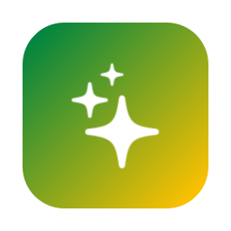

<p align="center">
  
</p>

<h1 align="center">Setal</h1>

<p align="center">
  <b>Réduire les « Données système » de ton Mac, sans risque.</b><br>
  Petite app macOS open source pour développeurs. Français · English · Español · Português
</p>

> *Setal* — « nettoyer, rendre propre » en wolof. Clin d'œil au mouvement
> **Set Setal** qui a vu la jeunesse de Dakar nettoyer la ville en 1990.
> [Read in English](README.md).

## Pourquoi

Sur un Mac de développeur, **Réglages › Stockage › Données système** dépasse
vite 200 Go. Ce n'est pas le système : c'est le disque virtuel de Docker, les
simulateurs iOS, les caches Gradle, les émulateurs Android, de vieux runtimes
Xcode, des `node_modules`…

Setal vient d'un vrai nettoyage : 203 Go de Données système, 34 Go libres.
Docker (47 Go), simulateurs iOS (25 Go), Gradle (18 Go) et émulateurs Android
(21 Go) en tête. Après : **139 Go libres**.

## Ce qu'elle nettoie

- **Onglet Données système** : Docker (Docker Desktop, OrbStack, Colima),
  Xcode et simulateurs (DerivedData, DeviceSupport, aperçus, runtimes
  obsolètes…), Android et Flutter, gestionnaires de paquets (npm, Yarn, pnpm,
  bun, Homebrew, uv, Cargo, Go, Maven, `~/.cache`), anciennes versions d'IDE,
  caches des apps Electron et Chrome, mises à jour iOS, sauvegardes iPhone,
  installeurs dans Téléchargements, caches, journaux, instantanés Time
  Machine, Corbeille.
- **Onglet Projets** : `node_modules`, `build`, `.dart_tool`, `Pods`,
  `.gradle`, `target`, `.build`, `.next`… dans ton dossier de code. Les
  projets inactifs depuis 30 jours (réglable) sont présélectionnés.

## Sécurité

- **Analyse d'abord**, rien n'est supprimé avant « Nettoyer ».
- **Trois niveaux de risque** : Sûr · À reconstruire · Perte de données
  (jamais coché par défaut, toujours confirmé).
- **Garde-fou** : suppression uniquement dans `~/Library/…` ou un dossier
  caché du home, jamais un dossier de premier niveau.
- **Tes fichiers vont à la Corbeille** : sauvegardes iPhone et installeurs
  sont mis à la Corbeille, pas supprimés.
- **Un artefact de projet doit être prouvé** : un dossier `build` n'est
  retenu que si le fichier de son écosystème est à côté, revérifié juste
  avant la suppression.
- **Journal** de chaque commande et chemin.

## Installer

Télécharger le `.zip` dans les [Releases](../../releases), ou :

```bash
./build-app.sh --install
```

L'app est signée ad hoc (pas notarisée) : au premier lancement, clic droit →
**Ouvrir**, ou **Réglages › Confidentialité et sécurité › Ouvrir quand même**.

## Langues

L'app suit la langue du système ; on peut la changer dans **Setal ›
Réglages… (⌘,)**. Textes dans `Resources/Localizable.xcstrings` ; après avoir
ajouté un texte : `./Scripts/sync-strings.sh`, puis traduire dans Xcode.

## Contribuer

Voir [CONTRIBUTING.md](CONTRIBUTING.md). Licence [MIT](LICENSE).
