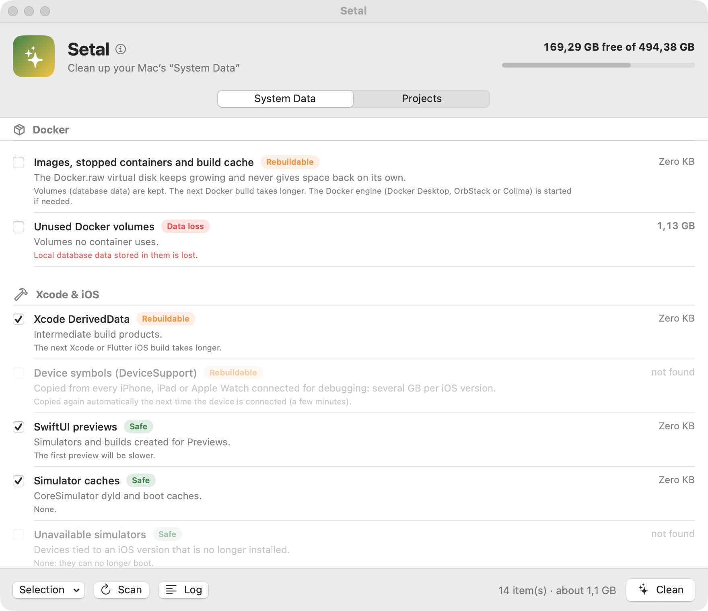

<p align="center">
  
</p>

<h1 align="center">Setal</h1>

<p align="center">
  <b>Shrink the “System Data” on your Mac — safely.</b><br>
  A small, open-source macOS app for developers.<br>
  English · Français · Español · Português · Deutsch · Italiano · Nederlands · Русский · Türkçe · العربية · 日本語 · 한국어 · 简体中文 · 繁體中文
</p>

<p align="center">
  
</p>

> *Setal* means “to clean, to make clean” in Wolof — a nod to **Set Setal**, the
> movement in which Dakar's youth cleaned up their city in 1990.
> [Lire en français](README.fr.md).

## Why

On a developer Mac, **Settings › Storage › System Data** quietly grows past
200 GB. It is not the system: it is Docker's virtual disk, iOS simulators,
Gradle caches, Android emulators, old Xcode runtimes, `node_modules`…

Setal was born from a real cleanup: System Data was at **203 GB** with 34 GB
left. Docker (47 GB), iOS simulators (25 GB), Gradle (18 GB) and Android
emulators (21 GB) were the main culprits. Afterwards: **139 GB free**.

## What it cleans

**System Data tab**

| Area | Items |
|---|---|
| Docker | images, stopped containers and build cache (volumes kept) · unused volumes — Docker Desktop, OrbStack or Colima |
| Xcode & iOS | DerivedData · DeviceSupport symbols · SwiftUI previews · simulator caches · unavailable simulators · outdated / unused simulator runtimes · simulator contents · archives |
| Android & Flutter | Gradle caches and wrapper distributions · Android cache · emulators (AVD) · system images · pub cache |
| Package managers | npm · Yarn Berry · pnpm · bun · Homebrew · uv · Cargo · Go modules · Maven · `~/.cache` tools |
| Editors & IDEs | settings of outdated JetBrains / Android Studio versions · VS Code caches |
| Apps & devices | Electron and Chrome caches · downloaded iOS updates · iPhone/iPad backups · installers in Downloads |
| Caches & system | `~/Library/Caches` · `~/Library/Logs` · local Time Machine snapshots · Trash |

**Projects tab** — finds regenerable build folders in your code folder:
`node_modules`, Flutter `build` and `.dart_tool`, Gradle `build` / `.gradle` /
`.cxx`, `Pods`, SwiftPM `.build`, Rust and Maven `target`, `.next`, `.nuxt`,
`.turbo`, `.svelte-kit`, `.parcel-cache`, `.angular`. Projects untouched for
30 days (configurable) are preselected.

## Safety model

Setal deletes things. It is built to make that boring:

- **Scan first.** Nothing is deleted until you press *Clean*. Every item shows
  its size and what happens after deletion.
- **Three risk levels.** *Safe* (pure cache) · *Rebuildable* (downloaded or
  compiled again) · *Data loss* — never preselected, always confirmed.
- **Path guard.** Deletion is only allowed inside `~/Library/…` or a hidden
  folder of your home (`~/.gradle/…`), never a top-level folder itself. Two
  narrow exceptions: emptying `~/.Trash` / `~/.cache`, and moving installers
  from `~/Downloads` *to the Trash*.
- **Your files go to the Trash.** iPhone backups and installers are moved to
  the Trash, not deleted.
- **Project artifacts need proof.** A `build` folder is only listed if its
  ecosystem file sits next to it (`pubspec.yaml`, `build.gradle`…), and this
  is checked again right before deletion. Symlinks are never followed;
  `site-packages` is never touched.
- **Everything is logged.** The Log window lists every command and path.

The rules live in [`PathGuard.swift`](Sources/SetalCore/PathGuard.swift) and
[`ProjectScanner.swift`](Sources/SetalCore/ProjectScanner.swift), and are
covered by tests.

## Support Setal

Setal is free and open source. If it saved you some gigabytes, you can
support its development:

<p align="center">
  <a href="https://paypal.me/sybirante"></a>
</p>

Starring the repository, reporting bugs and suggesting new cleanup targets
help just as much.

## Install

### Download

Grab `Setal-vX.Y.Z.zip` from [Releases](../../releases), unzip, and move
`Setal.app` to `/Applications`.

The app is ad-hoc signed, not notarized. The first time, macOS will refuse to
open it: right-click → **Open**, or go to **System Settings › Privacy &
Security › Open Anyway**. Alternatively:

```bash
xattr -dr com.apple.quarantine /Applications/Setal.app
```

### Build from source

Requires macOS 14+ and Xcode 15+.

```bash
# from a clone of this repository
./build-app.sh --install   # builds build/Setal.app and copies it to ~/Applications
```

## Permissions

Some items (iPhone backups, Trash) live in folders macOS protects. Setal shows
**Allow…** next to them: it opens **System Settings › Privacy & Security ›
Full Disk Access**, where you can enable Setal. Everything else works without it.

When Docker is stopped, macOS may ask whether Setal can access data from other
apps — that is Setal measuring Docker's disk image. You can decline.

## Languages

Setal follows the system language and can be switched in **Setal ›
Settings… (⌘,)**: English, French, Spanish, Portuguese, German, Italian,
Dutch, Russian, Turkish, Arabic (right-to-left), Japanese, Korean,
Simplified and Traditional Chinese. Native speakers are welcome to improve
the translations in `Resources/Localizable.xcstrings`.

## Development

```bash
swift test                    # core tests: path guard, scanners, parsers, catalog
swift run Setal               # run without bundling (texts stay in French)
./build-app.sh                # build/Setal.app
./Scripts/sync-strings.sh     # add new strings to the String Catalog
```

```
Sources/SetalCore/   testable logic: catalog, executor, path guard, scanners, shell
Sources/Setal/       SwiftUI interface
Resources/           Info.plist, Localizable.xcstrings (String Catalog)
Scripts/             icon generator, string sync
```

Adding a cleanup target is usually a single entry in
[`Catalog.swift`](Sources/SetalCore/Catalog.swift). See
[CONTRIBUTING.md](CONTRIBUTING.md).

## Not covered (on purpose)

- System-wide caches in `/Library` or `/private/var` (need admin rights).
- Old Xcode versions in `/Applications` — delete them from Finder.
- Mail and Messages attachments — personal data.

## License

[MIT](LICENSE) © 2026 Birante SY (OKEMAMY)
